# Batman DX — Gotham, finally in color

Sunsoft's Game Boy **Batman** (1990), fully colorized for Game Boy Color. One patch, six moods, a **Plus** edition that turns the whole game into Gotham at night, and an online lab to make your own.

<p align="center">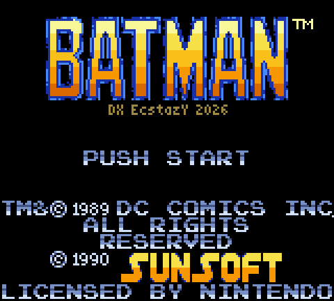</p>

The original game uses four shades of grey. Batman DX gives it color without touching a single game rule: same levels, same enemies, same difficulty, same speed. The cartridge still runs on a monochrome Game Boy, where it behaves like the original.

> This repository does **not** contain the game. It contains a patch that you apply to your own copy.

**Two editions.**

- **Batman DX**, the published edition: the game recolored, place by place. Same 128 KB cartridge.
- **Batman DX Plus**: Gotham at night. Scenery added and redrawn, two layers scrolling in the Batwing stages, lights that live, cleaner shots and items. The game itself does not change. It needs a 256 KB cartridge. [See what it adds](#batman-dx-plus).

Both can be played, changed and downloaded in the online lab.

## The easy way: the online lab

**[Open the Batman DX lab](https://guillain-rdcde.github.io/Batman-DX/)**

1. Drop your original ROM into the page.
2. Pick an edition or a mood.
3. Download the game in color, or play it right there.

Nothing is uploaded: everything happens in your browser.

<p align="center">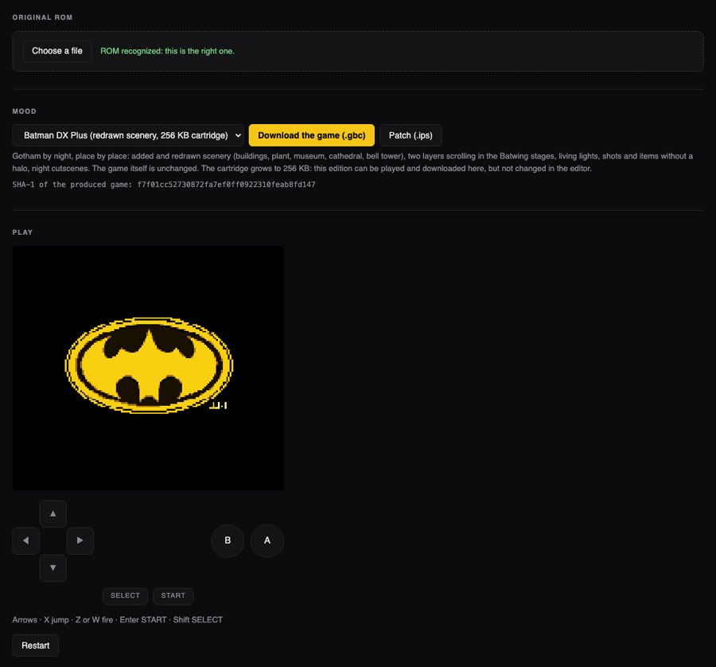</p>

### The editor

The lab is also an editor. It reads the levels and drawings straight from your ROM and shows each place with its real colors. From there you can:

- **change any color** of any place, background or characters;
- **tap a piece of scenery to give it another palette**;
- **give an object transparent edges**: the page shows the drawing enlarged, finds the background dots, and you correct them with a tap.

Then try the result in the page, download your own game or patch, and export your settings to share them.

The editor shows and edits the colors and the retouches of each place. It does not preview what the published edition adds on top: the sky gradient, the nightfall, the stained glass and the status bar touches. The game you play in the page or download has them all.

The editor works on every edition, the Plus edition included. For the Plus edition the preview replays its new drawings and the scenery it adds to the levels. As for the published edition, line effects (gradients, the two scrolling layers, living colors) do not show in the preview; the game has them. Drawings that the Plus edition has already redrawn cannot get transparent edges in the editor (the page says so); their colors can be changed like any other.

<p align="center">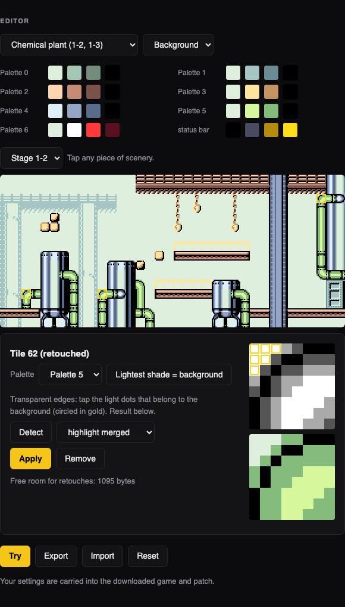</p>

## With an IPS patch

1. You need the ROM **Batman - The Video Game (World).gb**: 131,072 bytes, SHA-1 `ef7d6684a0f737c01a1f2cc2c6609e0f3ac1310e`.
2. Take a patch from [`patches/`](patches/): `Batman-DX.ips` is the published edition, `Batman-DX-plus.ips` the Plus edition, the others are the moods.
3. Apply it with any IPS tool (Lunar IPS, Floating IPS, or an online patcher).
4. Give the result a `.gbc` extension and run it in a Game Boy Color emulator.

If the game shows up in black and white, your emulator started it in Game Boy mode: force Game Boy Color mode.

The Plus patch also makes the file grow from 131,072 to 262,144 bytes. Floating IPS, Lunar IPS and the lab handle this; the result must be exactly 262,144 bytes.

## Batman DX Plus

The published edition recolors the game. The Plus edition goes further: every place becomes Gotham at night, with scenery added and redrawn, and a few effects the Game Boy Color allows but the original never used. **The game itself does not change**: same levels, same enemies, same timing, checked frame by frame against the original on every stage. It needs a 256 KB cartridge: the added half holds the new drawings, the added scenery and the code that runs the effects.

Published edition on the left, Plus on the right, at the same moment of the game.

**Gotham City (1-1, 2-1)**

<p align="center">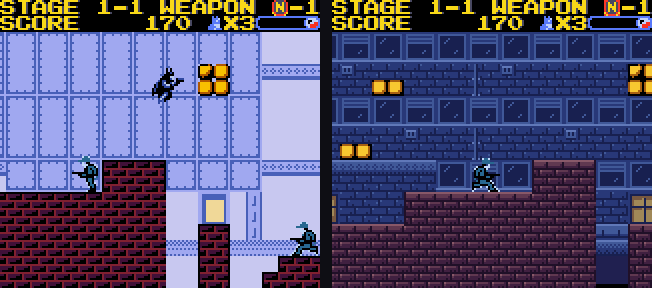</p>

**Chemical plant (1-2, 1-3)**

<p align="center">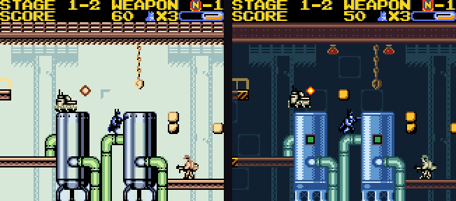</p>

**Batman vs Jack (1-B)**

<p align="center">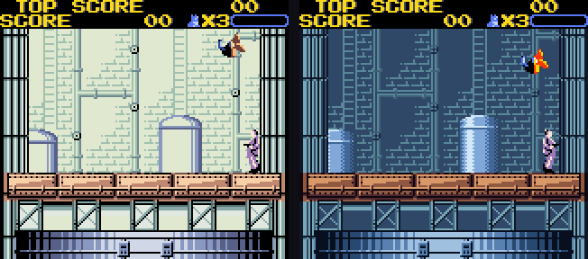</p>

**Flugelheim Museum (2-2, 2-3)**

<p align="center">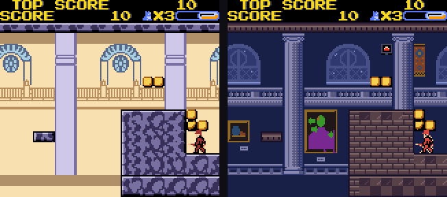</p>
<p align="center">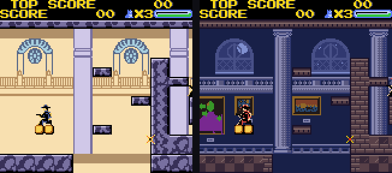</p>

**Batwing, sunset (3-1)**

<p align="center">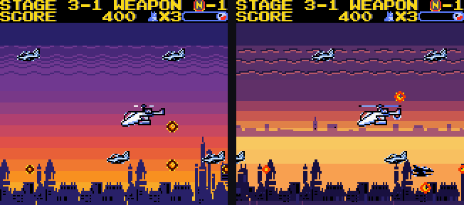</p>

**Batwing, night (3-2)**

<p align="center">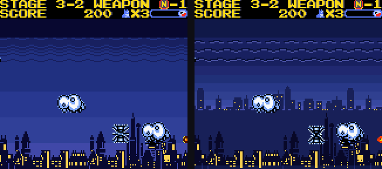</p>

**Cathedral (4-1, 4-2)**

<p align="center">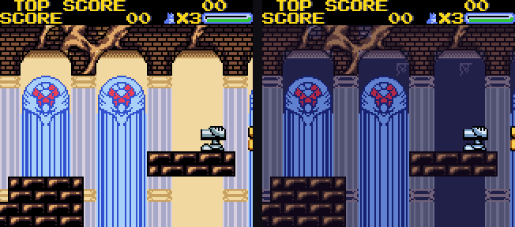</p>

**Batman vs the Joker (4-B)**

<p align="center">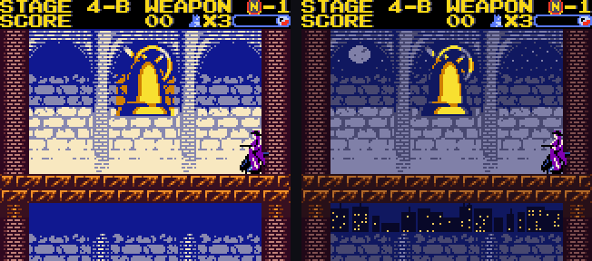</p>

**The Batcave, the Batmobile and the title screen**

<p align="center">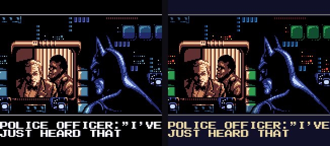</p>
<p align="center">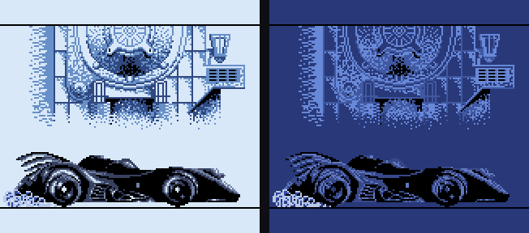</p>
<p align="center">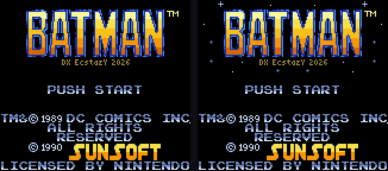</p>

### Place by place

- **Gotham City.** Real buildings drawn down to the street: cornices, setbacks, roofs, ground floors with shop windows and doors, awnings, drainpipes, air conditioners. Distant towers with their lights. A sky in gradient with one moon, stars and clouds. A neon sign that flickers and windows that switch on and off. Every light in the distant towers is a 2×2 square, like the windows. Puddles, manhole covers and gratings on the sidewalk. The scenery is kept subdued so that Batman, the enemies, the gold blocks and the items stand out.
- **Chemical plant.** Steel pipes, catwalks with safety stripes at both ends, riveted wall panels, beacons under the ceiling. The tanks are drawn as lit cylinders of polished chrome steel standing on cross-braced legs, with a porthole where the liquid bubbles; the round flanges where the green pipes enter them are green too. Puffs of steam rise from some pipes. The moving platforms are rust, like the catwalks.
- **Jack's room.** The vats are rounded cylinders; Jack keeps a single color when hit, and he falls into a green splash, as in the movie.
- **Flugelheim Museum.** The museum at night. Fluted marble columns with capitals and bases, a cornice, a balustrade, a dado rail, a checkered marble floor and dressed stone. Arched stained-glass windows lit by the moon: one in three shows the moon, and a slanted moonbeam falls below some of them. On the walls, paintings in gold frames with their labels, busts and vases on pedestals, tapestries. A few paintings have been defaced by the Joker in green and purple. Red alarm lights turn under the ceiling. Where the floor lies on the masonry, it is drawn in brick like the rest of the mass, as in the original game, so each mass reads as one block. The moving platforms are solid and bright copper, so they stand out against the paintings.
- **Batwing.** Two cities: a distant skyline, drawn for this edition, scrolls at half speed behind the game's own buildings, and thin clouds drift at a quarter speed. The foot of the distant city is solid, so the whole skyline moves as one block. In 3-1 the sunset glows under the horizon and night falls over the level; in 3-2 the city is lit and the moon sits directly on the sky.
- **Cathedral.** Night falls on the stone; the stained glass is deep sapphire with near-black leads and ruby, breathing in the moonlight. On the empty walls: candles that flicker, saints in niches, small Gothic stained-glass windows, cobwebs and cracks. The moving platform of 4-2 is solid and bright copper.
- **Bell tower.** Moonlit stone, a round yellow moon and twinkling yellow stars in the arches, and the shadow of the floor as a dark gradient below it. Only the bell is gold.
- **Everywhere.** Shots, muzzle flashes and explosions lose the white halo they had: that shade was a very light grey on the Game Boy, hardly visible on its light screen. Items released by blocks are plain shapes (a heart, a bat, a round “B”); the weapon and the extra life keep the game's own black-and-white drawing on its white square. A broken block throws small round sparks. Enemy bullets are a small glowing pearl. The bats that circle Batman as a shield are tiny Batman logos, a black bat in a yellow oval. Enemies are one shade brighter on the dark walls and no longer change color between two frames of their animation; when hit, they flash in a lighter shade of their own color. Batman keeps his colors, cape included, when he falls.
- **Fixed screens.** Dark dialogue boxes with cream letters, Batcave consoles with green screens and red and amber lights that blink, the Batmobile at night, stars around the title, placed to the dot in mirror image. The spinning bat emblem at power-on is metallic gold, light at the top, amber at the bottom, with a rebound of light. On the fallen Joker, only the top of his hair is green.
- **End credits.** Stars twinkle in the night sky, around the statue and under the scrolling text, and the statue's cape is fully opaque. Before THE END, the credits thank the people who helped with the DX version: Enker, Bodom and Rockfordlr.

From the Batwing stages on, one rule was kept: the game's own foreground drawings are recolored, never replaced. New drawings go on empty walls, in the sky and in the distance.

How it is done is explained in the [technical notes](TECHNICAL.md#the-plus-edition).

## Before, after

Original on the left, Batman DX on the right, at the same moment of the game.

**The logo**

<p align="center">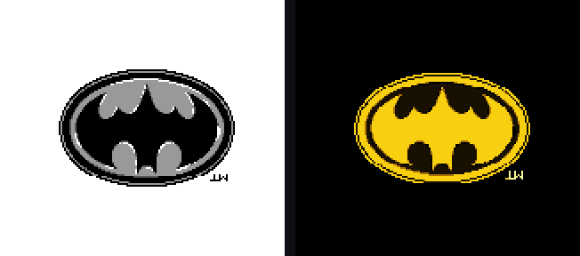</p>

**Title screen**

<p align="center">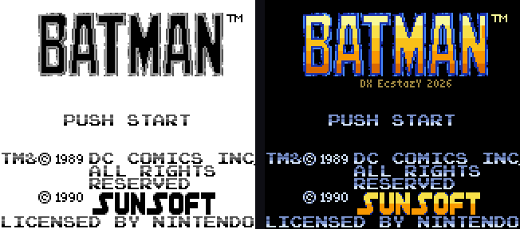</p>

**Scene: the police**

<p align="center">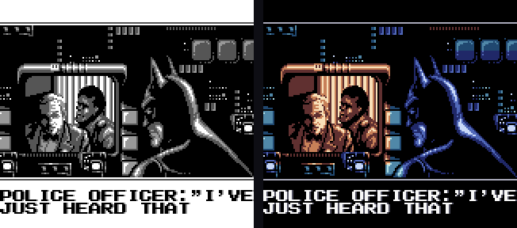</p>

**Gotham City (1-1, 2-1)**

<p align="center">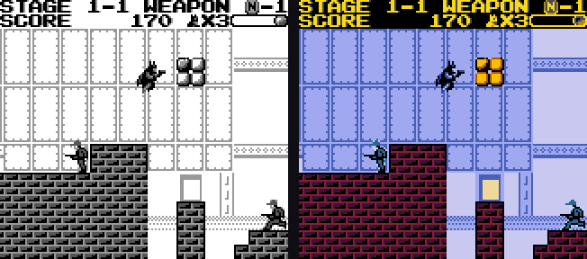</p>

**Chemical plant (1-2, 1-3)**

<p align="center">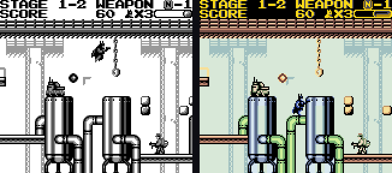</p>

**Batman vs Jack (1-B)**

<p align="center">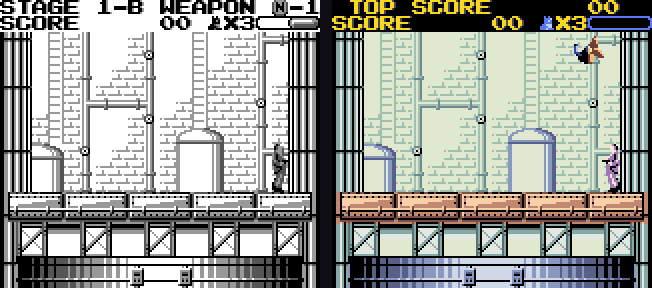</p>

**Scene: the Joker**

<p align="center">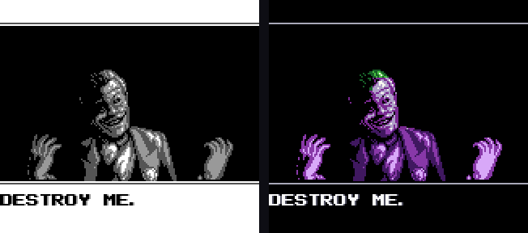</p>

**Flugelheim Museum (2-2, 2-3)**

<p align="center">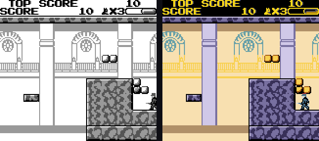</p>

**Scene: the Batmobile**

<p align="center">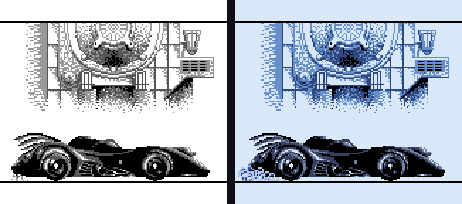</p>

**Batwing, sunset (3-1)**

<p align="center">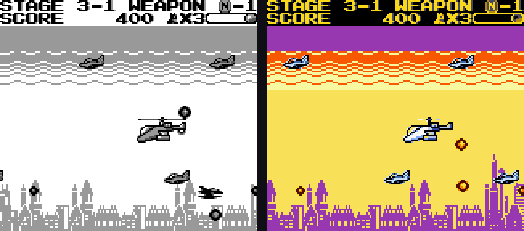</p>

**Batwing, night (3-2)**

<p align="center">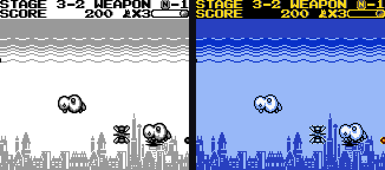</p>

**Scene: the Joker on screen**

<p align="center">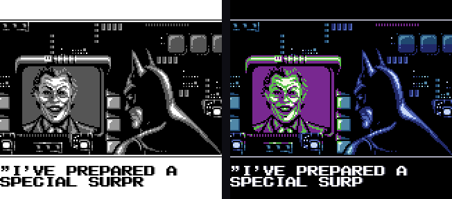</p>

**Cathedral (4-1, 4-2)**

<p align="center">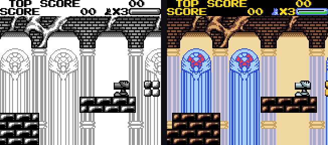</p>

**Batman vs the Joker (4-B)**

<p align="center">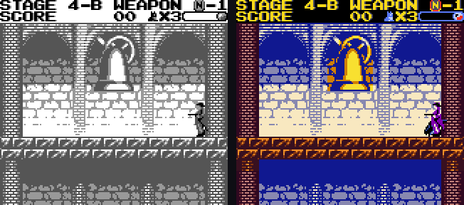</p>

**Scene: the ending**

<p align="center">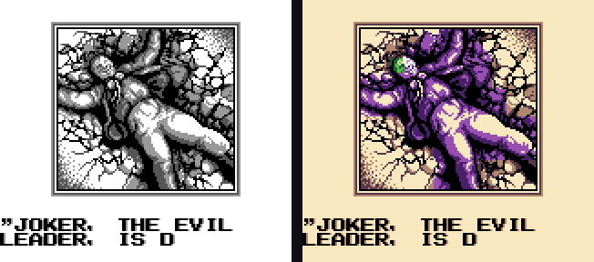</p>

**End credits**

<p align="center">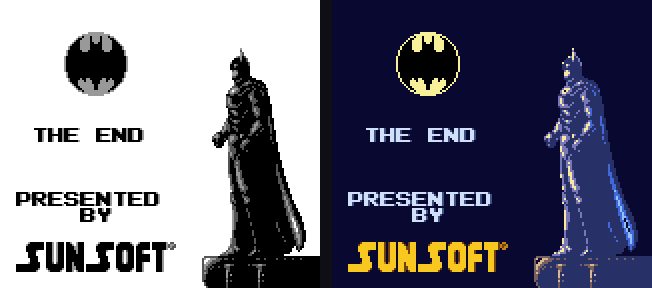</p>

**Game Over**

<p align="center">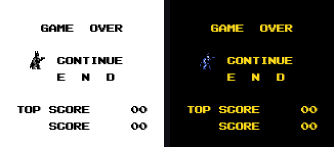</p>

## Six moods

`Batman-DX.ips` is the published edition: a mix chosen place by place, with every detail described below. The five others apply a single mood to the whole game.

<p align="center">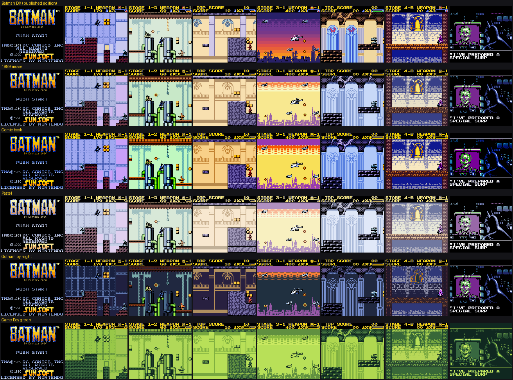</p>

| Patch | Mood |
|---|---|
| `Batman-DX.ips` | The published edition |
| `Batman-DX-movie.ips` | 1989 movie: the starting colors |
| `Batman-DX-comic.ips` | Comic book: bold colors |
| `Batman-DX-pastel.ips` | Pastel: everything softened |
| `Batman-DX-night.ips` | Gotham by night: dark backgrounds |
| `Batman-DX-green.ips` | Game Boy green: the four original greens |
| `Batman-DX-plus.ips` | Not a mood: the [Plus edition](#batman-dx-plus), 256 KB cartridge |

## The details that matter

<p align="center">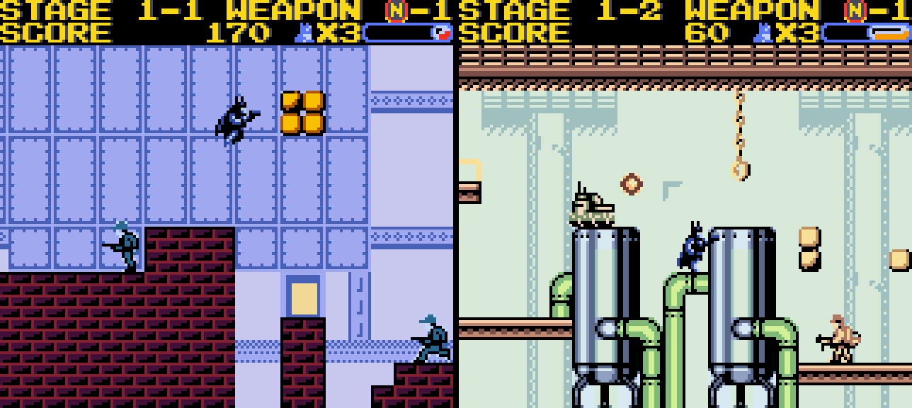</p>

- **Objects have transparent edges.** Barrels, pipes, blocks and pickups sit on the scenery with no colored square around them. To get there, about a hundred small drawings of the game are retouched at display time, on color hardware only.
- **Gotham's windows are lit**, and the distant towers are drawn as outlines on the sky so they recede.
- **The title screen shines**: a highlight sweeps down the letters once a second.
- **The status bar has its own touches**: Batman's icon is blue, the current weapon is ringed in red, and the energy gauge turns from green to orange to red.
- **Stage 3-1 is a real sunset.** The sky is a gradient redrawn line by line, from deep blue down to yellow on the horizon. Night falls as the level goes by and the city lights up, a few buildings at a time, until it reaches the blue night of stage 3-2.
- **Stained glass is glass.** In the museum and in the cathedral, the panes between the leads are filled; the cathedral gets marble columns.
- **Enemies are solid.** The cloud enemies of stage 3-2, the rockets, the airships, the airliner (its canopy stays clear), both Batwing bosses and the cathedral turrets were hollow in the original drawing, which did not show on a white sky; they are filled in so the scenery no longer shows through.
- **The title screen is centered** on the middle of the screen, to the dot: logo, emblem, signature and copyright lines.
- **Bosses flash** when hit, as in the original.

Night falling over stage 3-1, from the start of the level to the boss:

<p align="center">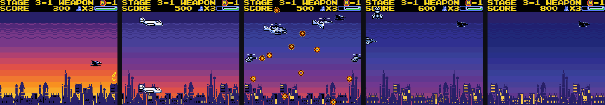</p>

A whole level, for scale:

<p align="center">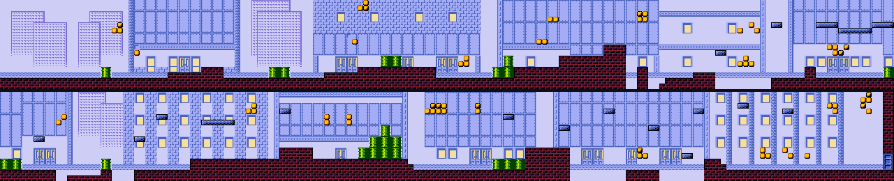</p>

## What has been verified

- **The game is the same.** The original and Batman DX receive exactly the same inputs and their memory is compared at every frame, over 12,000 game frames per stage. In monochrome it is identical on every in-game frame compared. In color it is identical on ten of the twelve playable stages; on the two others, one to three frames out of about 5,000 differ, in the list of displayed characters only, where the two games were not sampled on the same frame, and they are identical again right after.
- **The pace holds.** The work added at the end of each frame always finishes before the limit. Over long automatic playthroughs the game never stalls and runs 0.1 to 0.5 % fewer frames than the previous edition.
- **The game's own effects are untouched.** The level opening, drawn line by line by the original game, is compared picture by picture in monochrome and matches as closely as the previous edition did.
- **The patches are reproducible.** Rebuilding from source gives the seven ROMs byte for byte, the Plus edition included.
- **The Plus edition plays the same game.** It is compared frame by frame with the original on all twelve playable stages, in color and in monochrome; the added scenery only goes into cells the game treats as empty, and is compared as empty. It runs at most 0.7 % slower than the original game, on stage 3-1 (the published edition: 0.4 %).
- **The online lab is tested end to end**: it produces exactly the same seven ROMs, and a game edited in the page is run in an emulator to check that the retouch is really there.

What has **not** been verified: the game on a real Game Boy Color (the Plus edition is being played on an Analogue Pocket), and a full playthrough of the Plus edition by a human. Every place was reached by jumping straight to it. Details are in the [technical notes](TECHNICAL.md#verification).

## Checksums of the produced games

```
6ca57cb947bfe2a132dc54280deb3f15fccdd52a  Batman-DX.gbc (published edition)
a6967ecb291a5782d61c5897e7f2291a157ffa06  Batman-DX-movie.gbc
ff3a3b8d92a8923a7a5a222c2139a5a58e4cada0  Batman-DX-comic.gbc
05fb008ad3b99e43bdc60385b0e3b210c87600d3  Batman-DX-pastel.gbc
28863fef90a8f746df6125be9b24bb8aa6b4cc6f  Batman-DX-night.gbc
baa0f4e60a8275fde47896a1e35a0c150e3220b0  Batman-DX-green.gbc
6033c04e3286c103e5679814d4d137b9b4975c47  Batman-DX-plus.gbc (Plus edition, 256 KB)
```

## Building from source

You need [RGBDS](https://rgbds.gbdev.io) and Python 3.

```sh
./build.sh "Batman - The Video Game (World).gb"         # the published edition
./build.sh "Batman - The Video Game (World).gb" night   # one mood
./build.sh "Batman - The Video Game (World).gb" plus    # the Plus edition (256 KB)
```

The result lands in `out/`. The script refuses to build if the added code overwrites anything but free cartridge space.

## Share your colors

In the lab, “Export my settings” produces a small `.json` file with your colors, palette choices and retouches. Open an issue on this repository with the file and a screenshot: the best ones will join the moods.

## The rules of the hardware

A Game Boy Color does not paint pixels freely. Everything in Batman DX works inside five rules:

- **The screen is a grid of 8×8 cells, and each cell gets one palette of 4 colors.** You cannot give two palettes to one cell.
- **Only 8 background palettes exist at a time**, plus 8 for characters. Gotham uses all eight.
- **A drawing is made of 4 shades, not colors.** The palette decides what each shade looks like. The same drawing can be recolored, but two parts drawn in the same shade always share a color.
- **The background has no transparency.** Only characters do. A barrel is background.
- **The same small drawing is reused everywhere.** Recolor one brick and every identical brick of the level follows.

So why did barrels first show a colored square around them? In the original drawing, the lightest shade is used twice: for the highlight on the barrel and for the empty corners around it. One shade, one color: a bright highlight meant bright corners. The fix is to redraw the barrel so the corners keep the lightest shade, now set to the sky color, while the highlight moves to the next shade. The barrel loses one nuance and its corners melt into the sky. That is what “transparent” means here, and it only works where the scenery behind is a single flat color.

The [technical notes](TECHNICAL.md) explain the game, the patch and the verification, address by address.

## Credits

Batman DX is a non-commercial fan work, not affiliated with Sunsoft, Nintendo, DC or Warner Bros. *Batman* and its characters are trademarks of DC. The code in this repository is MIT licensed, except the lab page (`docs/`), under GPL-3.0 because it embeds the WasmBoy emulator; it contains no part of the original game beyond what the patch necessarily has to modify.

By Guillain d'Erceville. Signed “DX EcstazY 2026” on the title screen.
